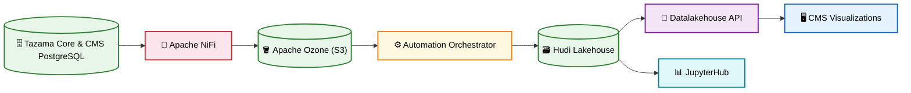

# Tazama Business Intelligence, Analytics and Reporting (BIAR)

Tazama Business Intelligence, Analytics and Reporting (BIAR) is the data lakehouse of the Tazama ecosystem. It continuously ingests data from the Tazama core and Case Management System (CMS) databases, processes it into Apache Hudi tables organised in Bronze, Silver and Gold layers, and serves it to the CMS investigation visualizations, to JupyterHub analytics dashboards and to a full-text search index of case evidence.

**What BIAR is:**
- A data ingestion pipeline built on Apache NiFi that extracts new rows from the Tazama core and CMS PostgreSQL databases every minute
- An S3-compatible landing store built on Apache Ozone
- A PySpark ETL orchestrator that writes Apache Hudi Bronze, Silver and Gold tables and builds the views used by CMS
- A tenant-aware query API (Datalakehouse API) that serves Gold tables and views to CMS
- A multi-user analytics environment (JupyterHub) with pre-built fraud, case and TMS performance dashboards
- A document processing pipeline that extracts the text of CMS evidence files with Apache Tika and indexes it in Apache Solr

## Architecture

### High-Level Flow



### Components

| Component | Description | Port |
| --- | --- | --- |
| **nifi** | Apache NiFi 1.24.0 with the Tazama flow template (`tazama.xml`). Polls the source tables, writes JSON files to Ozone and triggers the orchestrator. | 8088 (HTTP) / 8443 (HTTPS), 8081 |
| **automation-orchestrator** | FastAPI + PySpark service. Receives `/checksubmit` from NiFi, queues ETL jobs, writes Hudi Bronze/Silver/Gold tables and rebuilds the views. | 7619 |
| **datalakehouse-api** | FastAPI + PySpark query API. Verifies the caller's JWT (`QUERY_LAKEHOUSE` claim) and filters every query to the caller's tenant. | 8282 |
| **JupyterHub** | Multi-user JupyterLab environment with pre-built analytics dashboards. Keycloak or native login. | 8000 |
| **unstructured-pipeline** | TypeScript cron job: reads CMS evidence from CouchDB, decrypts it, extracts text with Tika, indexes it in Solr and forwards it to NiFi. | — |

Supporting services started by Docker Compose: Apache Ozone (SCM, OM, three datanodes, Recon, S3 Gateway), Apache Tika, Apache Solr and the `aws-cli` / `nifi-init` initialisation containers.

---

## Quick Start

### Prerequisites

- Docker & Docker Compose
- At least 8 GB of memory available to Docker
- A running Tazama core (PostgreSQL) and CMS (PostgreSQL and CouchDB)
- The Tazama Auth Service public key (`public.pem`)

### 1. Clone the Repository

```bash
git clone https://github.com/tazama-lf/biar.git
cd biar
```

### 2. Configure Environment

```bash
# Create environment file
cp .env.example .env

# Configure services in .env
# Key variables:
# - SERVER_B_HOST, SERVER_C_HOST (CMS host, this host)
# - TAZAMA_WAREHOUSE_HOST_PATH (Hudi warehouse folder on the host)
# - TAZAMA_AUTH_PUBLIC_KEY_HOST_PATH (Auth Service public key)
# - S3A_ACCESS_KEY, S3A_SECRET_KEY (Ozone S3 credentials)
# - COUCHDB_URL (CMS evidence database)
# - NIFI_AUTH (none | keycloak)
# - JUPYTERHUB_AUTH (keycloak | native)
```

### 3. Docker Compose Setup (Full Environment)

```bash
# From root directory, start the entire stack
docker compose up -d

# This starts:
# - Apache NiFi (port 8088) and nifi-init
# - Apache Ozone (S3 Gateway port 9878, Recon port 9888) and aws-cli
# - Automation Orchestrator (port 7619)
# - Datalakehouse API (port 8282)
# - JupyterHub (port 8888)
# - Apache Tika (port 9998) and Apache Solr (port 8983)
# - Unstructured Pipeline
```

### 4. Configure NiFi

After the first start, open NiFi at http://localhost:8088/nifi, set the URL, user and password of the six `DBCPConnectionPool` controller services to your Tazama core and CMS databases, enable them, and start the flow. See the deployment guide for details.

---

## Project Structure

### Root Directory

```
biar/
├── automation-orchestrator/              # PySpark ETL orchestrator (FastAPI)
│   ├── automation_orchestrator_api.py   # /checksubmit and /health endpoints, job queue
│   ├── lakehouse_automation_pipeline.py # ETL routing (table → ETL class)
│   ├── Table_ETLs/                      # One ETL class per table, plus view builders
│   ├── rebuild_metrics_tms.py           # One-off rebuild of gold/metrics/tms
│   └── spark_utils.py                   # Spark session factory
├── datalakehouse-api/                    # Tenant-aware query API (FastAPI)
│   ├── lakehouse_query_api.py           # /query, /execute_sql, /tables, /health
│   ├── auth.py                          # JWT verification
│   └── tests/                           # pytest tests
├── JupyterHub/                           # JupyterHub image and configuration
│   ├── jupyterhub_config.py             # Keycloak / native authentication
│   └── notebooks/                       # Analytics dashboards
├── nifi/                                 # NiFi image, flow template and init scripts
│   ├── tazama.xml                       # Flow template
│   ├── init.sh                          # Parameter context and template import
│   └── README.md                        # NiFi authentication modes
├── unstructured-pipeline/                # Evidence text extraction and indexing (TypeScript)
│   ├── src/
│   │   ├── job.ts                       # Cron job
│   │   └── services/                    # CouchDB, decryption, Tika, Solr, NiFi clients
│   └── __test__/                        # Jest tests
├── docker-compose.yaml                   # Full BIAR stack
├── docker-config                         # Apache Ozone configuration
├── data-lineage.md                       # Field-level data lineage
└── .env.example                          # Environment variables template
```

---

## Development Commands

### Unstructured Pipeline Commands (from `unstructured-pipeline/`)

```bash
# Development
npm run dev              # Start with hot reload
npm run build            # Compile TypeScript
npm start                # Run compiled build

# Linting & Formatting
npm run lint             # ESLint + Prettier check
npm run fix:eslint       # Auto-fix ESLint issues
npm run fix:prettier     # Format code
```

### Python Services (from the repository root)

```bash
# Linting
pip install ruff
ruff check automation-orchestrator/ datalakehouse-api/ JupyterHub/
```

---

## Testing

### Unstructured Pipeline Testing

```bash
npm run test             # Unit tests
npm run test:watch       # Watch mode
npm run test:coverage    # Coverage report
```

### Datalakehouse API Testing

```bash
cd datalakehouse-api
pip install -r requirements.txt
pytest tests -v
```

### Automation Orchestrator Testing

The orchestrator tests start a local Spark session and need Java and PySpark 3.4.2.

```bash
cd automation-orchestrator
pip install -r requirements.txt pytest
pytest -v
```

---

## Deployment

### Environment Variables

```bash
# General
SERVER_B_HOST=your_server_host                        # CMS / extensions host (CouchDB)
SERVER_C_HOST=your_server_host                        # BIAR host
TAZAMA_WAREHOUSE_HOST_PATH=/opt/Tazama_Warehouse
TAZAMA_AUTH_PUBLIC_KEY_HOST_PATH=/opt/biar/secrets/tazama-public-key.pem
NUM_WORKERS=1
LOG_LEVEL=INFO

# Ozone S3
AWS_BUCKET_NAME=tazama
S3A_ENDPOINT=http://${SERVER_C_HOST}:9878
S3A_ACCESS_KEY=your_access_key
S3A_SECRET_KEY=your_secret_key

# Spark (Automation Orchestrator)
SPARK_MASTER=local[3]
SPARK_DRIVER_MEMORY=6g
SPARK_EXECUTOR_MEMORY=6g

# Spark (Datalakehouse API)
QUERY_API_SPARK_MASTER=local[2]
QUERY_API_SPARK_DRIVER_MEMORY=2g

# NiFi
NIFI_PORT=8088
NIFI_AUTH=none                                        # none (local only) or keycloak
PB_BUCKET=tazama
PB_HTTP_VALUE=http://${SERVER_C_HOST}:7619/checksubmit
PB_OZONE_ENDPOINT=http://${SERVER_C_HOST}:9878

# JupyterHub
JUPYTERHUB_PORT=8888
JUPYTERHUB_AUTH=native                                # keycloak (default) requires KEYCLOAK_* settings
JUPYTERHUB_ADMIN=admin

# Unstructured Pipeline
COUCHDB_URL=http://username:password@${SERVER_B_HOST}:5984/cms-evidence
TIKA_URL=http://${SERVER_C_HOST}:9998
SOLR_URL=http://${SERVER_C_HOST}:8983/solr/biar_docs
NIFI_URL=http://${SERVER_C_HOST}:8081
CRON_SCHEDULE=*/30 * * * * *
MAX_FILE_SIZE_MB=50
```

### Docker Deployment

```bash
# Build and start the full stack
docker compose up -d --build

# View logs
docker compose logs -f automation-orchestrator

# Stop services
docker compose down
```

Please refer to the deployment guide here: https://github.com/tazama-lf/docs/blob/dev/Technical/Deployment-Guides/BIAR-Deployment-Guide.md

---

## Security

- **JWT Validation**: The Datalakehouse API verifies RS256 tokens with the Tazama Auth Service public key and requires the `QUERY_LAKEHOUSE` claim
- **Tenant Isolation**: Every Datalakehouse API query is filtered to the caller's `tenantId`
- **Read-Only SQL**: `/execute_sql` accepts only `SELECT` / `WITH` statements
- **NiFi Authentication**: `NIFI_AUTH=keycloak` enables HTTPS with Keycloak login (`NIFI_ADMIN` role); `none` is for local development only (see [nifi/README.md](nifi/README.md))
- **JupyterHub Authentication**: Keycloak login (`JUPYTER_USER` / `JUPYTER_ADMIN` roles) or native accounts
- **Evidence Decryption**: CMS evidence is decrypted only in memory before text extraction

---

## Features

### Data Ingestion

- **Incremental Extraction**: NiFi polls each source table every minute using a watermark column
- **Sources**: Tazama core (`event_history`, `raw_history`, `evaluation`, `configuration`, `enrichment`) and CMS (`tazama_cms`)
- **Landing Zone**: Raw JSON files stored in the Ozone `tazama` bucket

### Lakehouse Processing

- **Medallion Architecture**: Bronze (raw), Silver (typed, deduplicated, validated) and Gold (analytics-ready) Hudi tables
- **Data Quality**: Rejected alert and task rows written to dead-letter tables
- **Views**: Alert navigator, transaction detail and history, transaction networks, alert history and conditions timeline
- **TMS Metrics**: Pre-aggregated `gold/metrics/tms` table refreshed when transactions or evaluations change

### Query API

- **Structured Query**: `POST /query` on a single table with filters and columns
- **SQL Query**: `POST /execute_sql` over Gold tables and views
- **Schema Cache**: `POST /invalidate_schema_cache` after source schema changes

### Analytics Dashboards

- **Executive Overview** — Headline KPIs
- **Fraud Trend Analysis** — Fraud patterns over time
- **Fraud Typology Effectiveness** — Per-typology hit rate and effectiveness
- **Case Management Trend & Case Tracking Analysis** — Case volumes, resolution and escalation
- **TMS Performance** — Transactions received vs evaluated and evaluation latency
- **Anomaly Detection & Rule Calibration, Rule Discovery** — Rule tuning and discovery
- **Lakehouse Catalog & Query** — Table browsing and ad-hoc queries

### Evidence Search

- **Text Extraction**: PDF, Office and image documents processed by Apache Tika
- **Full-Text Index**: Extracted content indexed in the Solr `biar_docs` core
- **Status Tracking**: Processed documents marked as completed in CouchDB

---

## Technology Stack

### Data Processing

- **Apache Spark 3.4.2 (PySpark)** — Distributed processing
- **Apache Hudi 0.14.1** — Lakehouse table format
- **Python 3.9** — Runtime
- **FastAPI + Uvicorn** — Orchestrator and query APIs
- **PyJWT** — Token verification

### Ingestion & Storage

- **Apache NiFi 1.24.0** — Data flow orchestration
- **Apache Ozone 2.0.0** — S3-compatible object storage

### Analytics

- **JupyterHub / JupyterLab** — Multi-user notebooks
- **pandas, Plotly, Matplotlib, Seaborn** — Analysis and charts
- **scikit-learn, XGBoost, SHAP, UMAP** — Machine learning

### Document Processing

- **Node.js / TypeScript** — Unstructured pipeline runtime
- **Apache Tika** — Text and metadata extraction
- **Apache Solr 9** — Full-text search
- **CouchDB** — Evidence source (CMS)

### Infrastructure

- **Docker & Docker Compose** — Containerization
- **Keycloak** — Identity provider (external)

---

# For support or questions

- Review existing issues, discussions and pull requests
- Start a discussion in the **Discussions** tab or create an issue in the **Issues** tab in this repository
- Join the Tazama Slack workspace and post your question in the **#get-help** channel - :point_right: Join here: https://slack.tazama.org

---

## License

This project is licensed under the [Apache License 2.0](LICENSE).
